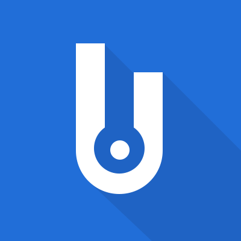
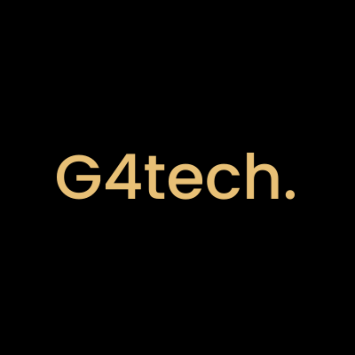
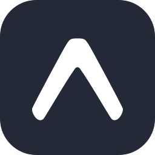
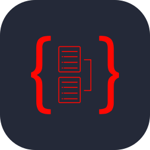
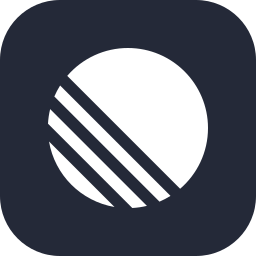
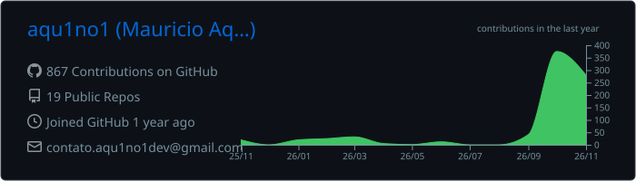
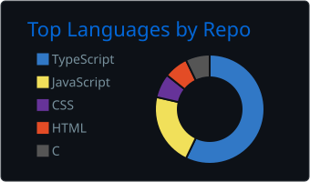
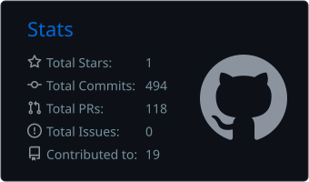

 

 

---

###  About me

Hi, I'm Mauricio.

- 6th-semester **Software Engineering** student at **UTFPR** (Cornélio Procópio campus).
- **Full stack** developer, mostly working with **TypeScript**.
- I enjoy following a project all the way from the database to the screen.
- Currently at **Unect Jr.** and **G4tech**.
- Starting in **2027.1**, I'll be the **Development Manager** at **Unect Jr.**
- Currently studying **Data Structures** and **System Design**.

---

###  Education

<table>
<tr>
<td width="50%" align="center" valign="top">

<h4>UTFPR · Federal University of Technology – Paraná</h4>

<b>B.S. in Software Engineering</b>

Cornélio Procópio campus · currently in the 6th semester

</td>
<td width="50%" align="center" valign="top">

<h4>Etec Lauro Gomes</h4>

<b>Technical Degree in Mechatronics</b>

São Bernardo do Campo, SP

PROJECTS

</td>
</tr>
</table>

<b>See earlier education</b>

 

<table>
<tr>
<td align="center" valign="top">

<h4>E.E. Profª Neusa Figueiredo Marçal</h4>

<b>Elementary and High School</b>

São Bernardo do Campo, SP

</td>
</tr>
</table>

---

###  Experience

<table>
<tr>
<td width="50%" align="center" valign="top">

<h4>Unect Jr.</h4>

<b>Backend Advisor</b>

🚀 <b>Next cycle (2027.1):</b> Development Manager

Helped build systems for medical clinics, working on the API, business rules and database. I like to get ahead of problems and I'm always ready to help the team.

</td>
<td width="50%" align="center" valign="top">

<h4>G4tech</h4>

<b>Junior Full Stack Developer</b>

Started as an intern and was promoted to junior developer. Worked on web and mobile projects and on the backend, from building interfaces to integrating APIs.

</td>
</tr>
</table>

---

###  Projects

<!-- Projetos em andamento. Gerado automaticamente por .github/workflows/projects.yml a partir de projects.json -->

<!-- PROJECTS:START -->
<table>
<tr>
<td width="50%" align="center" valign="top">
<h4><a href="https://github.com/aqu1no1/database-backup-utility">database-backup-utility</a></h4>

A cross-platform database backup and restore utility built with Rust, featuring a CLI, Tauri desktop app, automated scheduling, compression, and local/cloud storage support.

updated yesterday

</td>
<td width="50%" align="center" valign="top">
<h4><a href="https://github.com/aqu1no1/dotnet-task-manager-api">dotnet-task-manager-api</a></h4>

RESTful task management API built with ASP.NET Core, Entity Framework Core, and PostgreSQL.

updated 29 days ago

</td>
</tr>
</table>
<!-- PROJECTS:END -->

---

###  Finished Projects

<!-- FINISHED:START -->

<b>See finished projects (2 projects)</b>

 

<table>
<tr>
<td width="50%" align="center" valign="top">
<h4>Currency Converter</h4>

Full currency conversion platform with daily exchange rates since 2000: a NestJS REST API, a React web app and a React Native mobile app with historical rate charts.

<a href="https://github.com/aqu1no1/currency-converter-api"><b>🔌 API</b></a> &nbsp;·&nbsp; <a href="https://github.com/aqu1no1/currency-converter-web"><b>🌐 Web</b></a> &nbsp;·&nbsp; <a href="https://github.com/aqu1no1/currency-converter-app"><b>📱 App</b></a>

  

✅ finished

</td>
<td width="50%" align="center" valign="top">
<h4><a href="https://github.com/aqu1no1/nest-url-shortener">nest-url-shortener</a></h4>

A URL shortening REST API built with NestJS, Prisma, and PostgreSQL, featuring database migrations, automated testing, and CI/CD.

  

✅ finished

</td>
</tr>
</table>

<!-- FINISHED:END -->

---

###  Tech Stack

&nbsp;
&nbsp;
&nbsp;
&nbsp;
&nbsp;
&nbsp;
&nbsp;
&nbsp;
&nbsp;

 
&nbsp;
&nbsp;
&nbsp;
&nbsp;
&nbsp;
&nbsp;
&nbsp;
&nbsp;
&nbsp;

 

<b>See full stack</b>

 

<h4>Languages</h4>

<h4>Frameworks</h4>

React, React Native, Expo, Node.js, Express and NestJS

<h4>Databases</h4>

<h4>ORMs</h4>

Prisma and TypeORM

<h4>API Testing</h4>

Postman and Bruno

<h4>Documentation</h4>

Notion and Linear

<h4>DevOps & Version Control</h4>

<h4>Operating Systems</h4>

---

###  GitHub Stats

  

